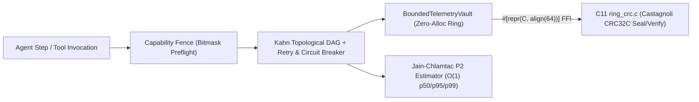

# polyglot-agent-runtime-rs

[](LICENSE)
[](Cargo.toml)
[](c_src/ring_crc.c)
[](Cargo.toml)

Deterministic, zero-dependency **Rust 2021 + ISO C11 FFI** systems runtime engineered for sub-microsecond AI agent telemetry, capability-fenced DAG orchestration, and constant-memory (`O(1)`) streaming tail-latency estimation.

---

## RFC System Architecture



---

## Empirical Release Benchmarks (`cargo run --release --bin bench_runtime`)

| Subsystem | Workload | Throughput | Unit Cost / Latency | $p_{50}$ Latency | $p_{95}$ Latency | $p_{99}$ Latency | Memory Invariant |
| :--- | ---: | ---: | ---: | ---: | ---: | ---: | :--- |
| **C11 CRC32C Ring Vault (`seal + validate`)** | `1,000,000` ops | **`2,938,386 ops/s`** | **`340.3 ns/op`** | **`0.3241 µs`** | **`0.3819 µs`** | **`0.4935 µs`** | `0` heap allocs post-init (`256 B/slot`) |
| **Capability-Fenced DAG (`6` nodes)** | `50,000` DAGs | **`432,904 DAGs/s`** | **`2.31 µs/DAG`** | **`2.060 µs`** | **`3.751 µs`** | **`4.299 µs`** | Deterministic `BTreeSet` Kahn queue |
| **Jain-Chlamtac $P^2$ (`p50/p95/p99`)** | `2,000,000` obs | **`38,009,399 obs/s`** | **`26.3 ns/obs`** | — | — | — | **`560 B` (`O(1)` constant state)** |

---

## C11 FFI & Memory Safety Invariants

1. **Exact Cache-Line ABI Parity (`64` Bytes)**:
   - C11 `ParRingSlotHeader` enforces `_Alignas(64)` and compile-time `_Static_assert(sizeof(ParRingSlotHeader) == 64U)` + `_Static_assert(offsetof(ParRingSlotHeader, header_crc32c) == 40U)`.
   - Rust `RingSlotHeader` mirrors every field under `#[repr(C, align(64))]` with matching `const` size and alignment assertions, eliminating false sharing across adjacent cache lines.
2. **Strict Compiler Hygiene**:
   - `build.rs` compiles `c_src/ring_crc.c` with `-std=c11 -O3 -Wall -Wextra -Werror -Wpedantic` and links statically with zero external crate dependencies.
3. **Bounded Pointer Provenance & Zero Ownership Transfer**:
   - Every `unsafe` FFI call in `src/lib.rs` passes borrows whose lifetimes strictly outlive the synchronous C11 checksum/header routine; C11 never allocates, frees, or retains Rust pointers.
4. **Dual-Stage Integrity Verification**:
   - `par_ring_header_validate` checks non-null pointers, `64`-byte pointer alignment, magic `0x50415231` (`"PAR1"`), version `1`, payload length bounds (`<= 192 B`), zeroed `20`-byte reserved region, header CRC32C, and Castagnoli payload CRC32C (verified against RFC 3720 check vector `0xE3069283`).

---

## Quickstart

### 1. Build, Lint & Run Full Test Suite
```bash
cargo clippy --all-targets -- -D warnings
cargo test --verbose
cargo run --release --bin bench_runtime
```

### 2. Rust Library Usage
```rust
use polyglot_agent_runtime::{
    capabilities, BoundedTelemetryVault, CapabilityDagOrchestrator, CircuitBreaker, DagNode,
    RetryPolicy, StreamingQuantileSuite,
};

let mut vault = BoundedTelemetryVault::<1024>::new();
vault.record(1_700_000_000, 1, capabilities::TELEMETRY_EMIT, 0, b"step:ok")?;
assert_eq!(vault.verify_all()?, 1);

let mut quantiles = StreamingQuantileSuite::new();
for sample_us in [12.4, 15.1, 11.8, 19.2, 14.0, 42.5] {
    quantiles.observe(sample_us);
}
let snap = quantiles.snapshot();
println!("p50={:.2}us p95={:.2}us bytes={}", snap.p50, snap.p95, snap.state_bytes);
```

### 3. Containerized Execution
```bash
docker build -t polyglot-agent-runtime-rs:1.0.0 .
docker run --rm polyglot-agent-runtime-rs:1.0.0
```

---

## License

Released under the [MIT License](LICENSE). Copyright (c) 2026 Nahian Akhtar.
